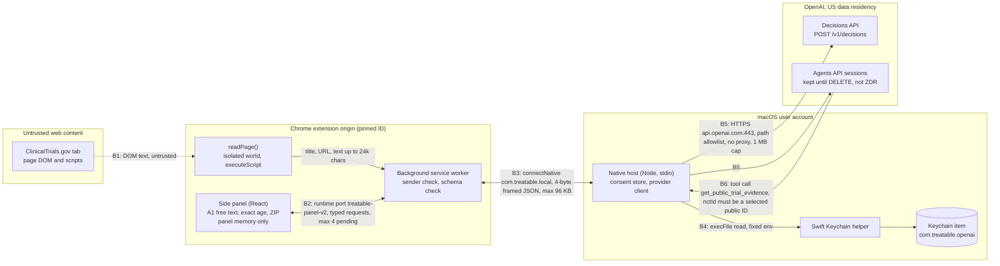

# Treatable threat model

| | |
|---|---|
| Product | Treatable Chrome MV3 extension 0.1.0 (`extension/`), Node native-messaging host and Swift Keychain helper (`extension/native/`) |
| Baseline source | `codex/treatable-mvp` @ `48c569e` (file:line references below point at that commit) |
| Date | 2026-10-24 |
| Operator | Kurt Lehnardt - Developer of Treatable · privacy/security contact privacy.6vpc5@mailer.me |
| Method | STRIDE per trust boundary, OWASP Top 10 for LLM Applications 2025, HIPAA Safe Harbor identifier walkthrough, AI-assisted adversarial review plus SAST, dependency audit and secret scanning (see [SECURITY.md](../../SECURITY.md#release-gate)) |

> Warning: this model is out of date. It describes the baseline above, which predates the toolbar overlay, the private live-matching port, the apply port, AI ranking and the trusted confirm-send window; none of those trust boundaries is modeled here. The legacy side-panel page (`panel.html`), its `treatable-panel-v2` runtime port and the A/B build variants it analyses were removed afterwards because nothing in the extension opened them. Treat every panel reference below as historical, and do not rely on this document as a current statement of the extension's boundaries until it is rewritten.

This is an engineering threat model for a minimum viable product. It is not a certification, a legal opinion or proof that no vulnerability exists. **Treatable is not a HIPAA-covered product, no Business Associate Agreement (BAA) exists with OpenAI, no HIPAA compliance is claimed, and minimized health information is not anonymous.**

Status labels used throughout:

- **Existing**: present in `48c569e` and covered by code or tests.
- **In progress (native)**: being added on branch `security/native-hardening`.
- **In progress (panel)**: being added on branch `security/panel-hardening`.
- **Accepted risk**: known, documented and not fixed for this release; see [§9](#9-residual-risks-and-limitations).

The orchestrator reconciles "in progress" rows with the sibling branches before merge. A row must not be called Existing until its change is merged and tested.

## 1. Scope and assets

In scope: the side panel and its React UI (`extension/src/`), the background service worker (`extension/src/background.ts`), the on-demand page reader (`extension/src/pageReader.ts`), the shared request/response contracts (`extension/shared/`), the manifest and CSP (`extension/manifest.json`), the native host, transport, provider client, consent store and installer (`extension/native/*.mjs`), the Swift Keychain helper (`extension/native/credential.swift`), and the build script (`extension/scripts/build.mjs`).

Out of scope: the legacy `scaffold/` web app, `installer/` and the root `install-*` scripts (not part of the demo), OpenAI's, Google's and Apple's own infrastructure, and the security of the user's operating system.

| Asset | Where it exists | Why it matters |
|---|---|---|
| A1. Patient free text: condition, notes, exact age, sex, ZIP | Mounted panel memory only (`src/patient-form.tsx`, `src/use-panel-controller.ts`) | Personal health information; the most sensitive asset |
| A2. Minimized real packet: age band, optional state, optional sex, 1–6 catalog condition IDs, 1–2 public NCT IDs | Panel memory; native host memory for up to 5 minutes (`native/real.mjs:17-25`); OpenAI after explicit confirmation | Still health information; not anonymous |
| A3. OpenAI API key | Dedicated Keychain item `com.treatable.openai`/`api-key` (an item saved by an earlier version is copied into it and verified, then deleted); transient native memory during a request | Spend, account access, access to stored Agents sessions |
| A4. Consent state: policy receipt, prepared token (32 random bytes), SHA-256 digest, per-operation one-use flags | Panel memory and native memory (`native/real.mjs:18-23`) | Binds what was shown to what is sent |
| A5. Provider-side session state | OpenAI Agents session until DELETE; abuse-monitoring logs | Retention outside our control |
| A6. Public catalog: 2,000 ClinicalTrials.gov records, 3,514 condition labels | Bundled, SHA-256 pinned (`scripts/build.mjs:22`, `native/real.mjs:10`) | Integrity of evidence and of tool output |
| A7. Integrity of what the UI shows: scores, questions, cautions | Panel | Patients may act on it; misinformation risk |
| A8. Extension identity and native registration | Manifest `key`, `NativeMessagingHosts/com.treatable.local.json` | Who may talk to the host |

## 2. Actors

| Actor | Capability assumed | Main goals |
|---|---|---|
| External penetration tester / reviewer | Reads the public repo, installs their own copy, uses DevTools on their own profile, sends arbitrary native frames from their own machine | Find any path where data leaves the documented packet, where the key is exposed, or where model text reaches the UI |
| Malicious web page | Arbitrary HTML/JS on any origin, including a lookalike of ClinicalTrials.gov | Get the extension to read, run or send something; message the extension |
| Hostile or poisoned trial record | Controls text inside a public ClinicalTrials.gov record (title, summary, criteria), including Unicode tricks | Indirect prompt injection; misleading the patient; steering the agent's tool use |
| Adversarial user | Full control of their own panel inputs | Steer the LLM, extract prompts, get free-form medical advice, smuggle free text into the API path, bypass consent |
| Other local software running as the same macOS user | Can run programs, read user files, spawn the launcher or the Keychain helper | Steal the API key; impersonate the extension to the host |
| Network attacker | On-path between the Mac and api.openai.com; can run a rogue Wi-Fi or proxy | Read or alter requests; steal the key |
| Provider-side retention | OpenAI stores session state and abuse-monitoring logs per its policies | Data persists after the panel closes |

Not modelled as defeatable: OS-level malware with root or the user's privileges and debugger access, a malicious browser extension with `debugger` or all-site permissions, a compromised Chrome binary, physical access to an unlocked Mac, a compromised OpenAI account.

## 3. Architecture and trust boundaries

Data flow in one paragraph: patient free text is typed into the panel and used there for local search over the bundled snapshot and offline ZIP centroids. Page text is read on demand from an exact ClinicalTrials.gov origin and shown locally; it is never sent to a model. The browser never calls OpenAI (`connect-src 'self'`, `manifest.json:22`). The default API demo sends a clearly fictional fixture. The optional real path sends only the minimized packet (A2) after a scroll-gated notice (`src/privacy-notice.tsx:6,15-16`) and an exact-payload preview; the native host pins both request bodies and the public tool outputs to a five-minute single-use token and a SHA-256 digest (`native/real.mjs:20-23`), and `executeReal` cannot replace the packet.

## 4. STRIDE per boundary

### B1. Web page ↔ page reader (`chrome.scripting.executeScript`)

| STRIDE | Threat | Control (file:line) | Status |
|---|---|---|---|
| S | Lookalike site impersonates ClinicalTrials.gov | Reader runs only if the active tab's origin is one of two exact origins (`src/sites.ts:3`, `src/background.ts:18`) and re-checks `location.origin` inside the page (`src/pageReader.ts:3`); host permissions are only `https://clinicaltrials.gov/*` and `https://www.clinicaltrials.gov/*` (`tests/sites-reader.test.ts:2`) | Existing |
| T | Page text carries hidden instructions, bidi or zero-width characters | Page text is local display/search data only, never model input; hidden, `aria-hidden` and form elements are skipped; text capped at 24,000 chars (`src/pageReader.ts:4,8,10-11`); rendered as React text, never HTML | Existing |
| T | Bidi/control characters make displayed text misleading | Unicode/control-character sanitization of third-party text before rendering | In progress (panel) |
| R | Page triggers a read without the user | Reads happen only on a `readPage` message from the panel itself (`src/background.ts:56`) | Existing |
| I | Reader captures what the user typed on the site (search boxes) | `input`, `textarea`, `select`, `form`, `contenteditable` and `role=textbox` are excluded, including from selections (`src/pageReader.ts:4-8`) | Existing |
| I | Page reads panel data | No content scripts, no `externally_connectable`, no web-accessible resources; the panel is a separate extension origin (`tests/sites-reader.test.ts:2`) | Existing |
| D | Very large or slow page | Text cap; failure returns one fixed message (`src/background.ts:56`) | Existing |
| E | Page script tampers with the reader | `executeScript` uses the default isolated world, so page JS cannot redefine the reader's globals; the reader is a self-contained function that receives the allowlist as an argument (`src/pageReader.ts:1-2`) | Existing |

### B2. Side panel ↔ background service worker

| STRIDE | Threat | Control (file:line) | Status |
|---|---|---|---|
| S | Another context connects to the panel port or sends `readPage` | `allowedPanel` requires same extension ID, no tab and the exact `panel.html` URL (`src/background.ts:6,8,56`) | Existing |
| S | Regressions in sender validation | Dedicated sender-validation and data-boundary regression tests | In progress (panel) |
| T | Malformed or extra-field requests | `parseDemoRequest`/`parseRealRequest` with exact keys and enums (`shared/demo-contract.mjs:13-23`, `shared/real-contract.mjs:18-24`); an invalid request closes the port (`src/background.ts:14`); replies are re-validated against the request ID and type (`src/background.ts:13`, `shared/demo-contract.mjs:24-39`) | Existing |
| R | User later disputes what was consented | Digest binds the exact bodies shown in the preview (`native/real.mjs:20`); no durable consent log by design (privacy trade-off) | Accepted risk |
| I | Free text crosses to the native host | The client only sends fixture IDs or the minimized packet (`src/native.ts:6,15-18`); unknown fields are rejected (`shared/real-contract.mjs:11`) | Existing |
| I | Browser persistence of patient data | No patient-data writes; the `storage` permission deletes the legacy key without reading it (`src/storage.ts:1-8`). The one other write is the enum-only display preference record `treatable.uiPrefs` (`src/ui-prefs.ts`), which rejects any other key or value | Existing |
| I | Spellcheck/autofill sends or stores health text (Chrome Enhanced Spell Check sends typed text to Google) | `autoComplete="off"`, `spellCheck={false}` on patient fields and the condition filter (`src/patient-form.tsx:4-8`, `src/real-panel.tsx:14`) | Existing (partial) |
| I | Same, for every remaining health field | Extend to all health inputs and selects | In progress (panel) |
| D | Panel floods the worker | At most 4 pending requests, duplicate IDs rejected, 150 s timer (`src/background.ts:14`) | Existing |
| E | Script injection into the panel | CSP `script-src 'self'; object-src 'none'; connect-src 'self'; base-uri 'none'; frame-src 'none'` (`manifest.json:22`); no `innerHTML`/`dangerouslySetInnerHTML`/`eval` in `src/` (Semgrep and grep, §10) | Existing |
| E | Remaining CSP gaps | Add `default-src 'none'`, `form-action 'none'`, `frame-ancestors 'none'` | In progress (panel) |
| E | Links to `http:` or odd schemes | `safeWebUrl` allows only `https:`/`http:` without credentials (`src/core.ts:12`) | Existing; https-only In progress (panel) |

### B3. Background ↔ native host (Chrome native messaging)

| STRIDE | Threat | Control (file:line) | Status |
|---|---|---|---|
| S | Another extension talks to the host | Host manifest has exactly one `allowed_origins` entry (`native/install.mjs:24`, `native/test/core.test.mjs:57`); the host re-checks the caller origin against its config (`native/host.mjs:12`, `native/core.mjs:7`); the installer refuses any other extension ID and, given `--manifest`, derives the ID from the manifest key and refuses a mismatch (`native/install.mjs:12-13`) | Existing |
| S | A same-user process runs the launcher directly with a forged origin argument | Not preventable at this layer. It gains only the same enum-only operations (fictional fixtures or a consented packet it supplies itself) and can spend the project budget; key access is covered by B4 | Accepted risk |
| T | Malformed frames | 4-byte little-endian length, 1 byte to 96 KB, fatal UTF-8 decode, JSON parse; any failure ends the session (`native/core.mjs:8-12`, `native/host.mjs:32`) | Existing |
| I | Error replies echo request data | Fixed code→message map; protocol failures never echo (`native/host.mjs:11,15,18,29`) | Existing |
| I | Remaining non-fixed replies | All host replies fixed strings | In progress (native) |
| D | Replay-ID set: after 1,000 requests every request is rejected until restart (`native/host.mjs:18`) | Bounded replay-ID set | In progress (native) |
| D | Concurrent operations | One provider operation at a time (`BUSY`, `native/host.mjs:23`) | Existing |
| E | Consent bypass or replay on the real path | `executeReal` accepts only a 43-char token, 64-hex digest, operation and current policy receipt; one use per operation; 5-minute TTL; any new prepare, revoke, cancel or disconnect clears it (`native/real.mjs:17-25`, `shared/real-contract.mjs:9,21`) | Existing |
| E | Timing side channel on token comparison (`!==`, `native/real.mjs:23`) | Constant-time compare. Low impact: the attacker already needs stdio access to the host | In progress (native) |

### B4. Native host ↔ Keychain helper

| STRIDE | Threat | Control (file:line) | Status |
|---|---|---|---|
| S | A same-user process runs `treatable-keychain read` with the pipe variable set and receives the key (the Keychain ACL trusts the helper; `credential.swift:53-64`) | Restricted-permission project key, low project budget, key rotation | Accepted risk |
| S | Same, mitigation | Installer helper-path restriction | In progress (native) |
| T | Helper binary swapped | Install directory and helper are `0700` (`native/install.mjs:14,20`); host resolves the helper's real path and requires it inside its own directory (`native/host.mjs:12`); a replaced binary triggers Keychain re-approval | Existing |
| T | Tighter installer permissions | Installer `chmod` hardening | In progress (native) |
| I | Key in argv, env, config, logs or browser | Setup refuses key arguments (`native/credentials-setup.mjs:9`); helper env is fixed `PATH`/`HOME`/`TMPDIR` (`native/credentials.mjs:6`); launcher uses `env -i` (`native/install.mjs:23`); key dropped after building the transport and cleared in `finally` (`native/host.mjs:28,30`); Swift zeroes its buffers (`credential.swift:22,29,63`); item not synchronizable (`credential.swift:36`) | Existing |
| I | JavaScript strings cannot be wiped from memory | None possible in JS | Accepted risk |
| D | Keychain locked or approval declined | Fixed `KEY_MISSING` (`native/credentials.mjs:9`) | Existing |
| T/I | Migration from the Keychain item of an earlier version (added after the baseline commit) | The copy happens only inside the helper process through Security framework calls; the key is never printed, logged, written to a file or passed through argv or environment variables. The new item uses the same non-synchronizable attributes as `configure`, is read back and compared before the earlier item is deleted. A failed copy or verification leaves the earlier item in place and in use; a failed deletion leaves both items, the new one in use, and `status` reports the pending migration (`credential.swift`, `migrate`). Tests run the logic against an in-memory store with the real Keychain calls compiled out (`native/test/credential-migration.test.mjs`); they need macOS and `swiftc`, so the Linux CI job skips them and they run only on macOS | Existing |
| T | `getpass()` reads at most 128 characters on macOS, so a longer project key is silently truncated (`credential.swift:18`) | Key entry via `readpassphrase` with an explicit buffer | In progress (native) |

### B5. Native host ↔ OpenAI (network)

| STRIDE | Threat | Control (file:line) | Status |
|---|---|---|---|
| S | On-path attacker, rogue proxy or CA | Fixed host `api.openai.com:443`, `rejectUnauthorized: true`, `agent: false`, redirects not followed (`native/transport.mjs:13`); `env -i` launcher blocks `HTTPS_PROXY`, `NODE_OPTIONS`, `NODE_TLS_REJECT_UNAUTHORIZED`, `NODE_EXTRA_CA_CERTS` (`native/install.mjs:23`); Node uses its bundled CA store, so a user-installed root CA is not trusted | Existing |
| S | Protocol downgrade | Node defaults to TLS 1.2 or later; explicit `minVersion: 'TLSv1.2'` and `servername` | Existing (default); explicit In progress (native) |
| T | Malformed or oversized responses | 1 MB body cap, 128 KB SSE buffer, fatal UTF-8, strict JSON (`native/transport.mjs:3,16-22`); strict output schemas (`native/provider.mjs:8,10`) | Existing |
| I | More data sent than consented | Real bodies are built and pinned in the host (`native/real.mjs:12-15,20`); a canary test proves RPC IDs, tokens, digests, private sentinels and operator contact are absent from provider traffic (`native/test/real.test.mjs:38`) | Existing |
| D | Hung provider | Decisions 25 s, Agents 90 s, cleanup budget 5.5 s (`native/provider.mjs:11,15,30`) | Existing |
| E | Host used as a generic HTTP client | Path regex allowlist and GET/POST/DELETE only (`native/transport.mjs:9`); provider session IDs validated before use in a path (`native/provider.mjs:6,14`) | Existing |

### B6. Provider-side processing, retention and the agent loop

| STRIDE | Threat | Control (file:line) | Status |
|---|---|---|---|
| I | Agents API keeps session state until deleted, does not support Zero Data Retention and only supports US data residency ([Agents API beta FAQ](https://help.openai.com/fr-fr/articles/20001551-agents-api-beta-faq)); default abuse-monitoring logs may keep content up to 30 days ([OpenAI data controls](https://developers.openai.com/api/docs/guides/your-data)) | Never send identifiers (§6); fictional fixture on stage; cancel then DELETE after each run and show the outcome (`native/provider.mjs:30-34`); retention flags only if OpenAI documents them | Accepted risk; flags In progress (native) |
| I | Deletion fails, or creation is lost before a session ID arrives | Cleanup marked `failed` and shown in the trace (`native/provider.mjs:34`) | Accepted risk |
| T/E | Poisoned trial text steers the agent to other tools, other studies or exfiltration | `environment: {type: 'none'}` (no sandbox or shell), `multi_agent` disabled, one function tool whose `nctId` is an enum of the run's selected IDs (`native/real.mjs:14`); each call validated, deduplicated, max 6 (`native/provider.mjs:21-22`); subagents rejected (`native/provider.mjs:19`); the tool returns only the pre-pinned public record | Existing |
| T | Tool-call arguments arrive as a JSON string instead of an object, so valid calls fail closed (`native/provider.mjs:22`, availability only) | Tolerant but allowlisted argument parsing | In progress (native) |
| T | Model text contains instructions or Unicode tricks from trial records | Prompts label public text as untrusted data (`native/real.mjs:13-14`, `shared/demo-fixtures.mjs:146,148`); sanitization and explicit untrusted-data labelling of third-party text | Existing (labels); sanitization In progress (native, panel) |
| R | Pseudonymous `safety_identifier` (optional Decisions parameter, see [promptfoo provider notes](https://www.promptfoo.dev/docs/providers/openai-decisions/)) | Not sent at `48c569e`. If added, it must be a random per-install value, never derived from patient data, and it counts as a unique code (§6, item 18) | n/a |
| S | Compromised OpenAI account or key | Dedicated project, restricted key, low budget, rotation | Out of scope / Accepted risk |

### B7. Build and supply chain

| STRIDE | Threat | Control | Status |
|---|---|---|---|
| T | Malicious dependency update | Three runtime dependencies pinned exactly (react 18.3.1, react-dom 18.3.1, zod 4.6.7) with lockfile integrity; CI runs `npm ci --ignore-scripts` and `npm audit --audit-level=high`; the native host imports only `node:` built-ins and `extension/shared/` | Existing; CI gate new on `security/docs-hardening` |
| T | Altered public catalog | SHA-256 checked at build and at host start (`scripts/build.mjs:22`, `native/real.mjs:10`) | Existing |
| I | Secrets committed to history | gitleaks full-history scan in CI with a triaged baseline (§10) | New on `security/docs-hardening` |
| T | Compromised CI action | Actions pinned to commit SHAs; gitleaks binary checksum-verified; Semgrep version pinned | New on `security/docs-hardening` |

## 5. OWASP Top 10 for LLM Applications 2025

Reference: [OWASP GenAI Security Project, LLM Top 10 2025](https://genai.owasp.org/llm-top-10/).

| ID | Risk | How it applies here | Controls (file:line) | Status |
|---|---|---|---|---|
| LLM01 | Prompt Injection | **Direct:** a user types "ignore previous instructions" into a form. **Indirect:** a trial record's summary or criteria carries instructions | Direct: on the API path the user can only choose enums and catalog IDs; free text never leaves the panel (`shared/real-contract.mjs:10-16`, `shared/demo-contract.mjs:18-20`). Indirect: public text is labelled untrusted data in both prompts (`native/real.mjs:13-14`, `shared/demo-fixtures.mjs:146,148`); outputs are reduced to IDs and numbers (LLM05); the only tool takes an enum `nctId` (LLM06). Worst realistic outcome: a wrong relevance index or a different choice among fixed question templates | Existing; Unicode/control sanitization and untrusted-data labelling of third-party text In progress (native, panel) |
| LLM02 | Sensitive Information Disclosure | Health data reaching the provider; the key or consent tokens leaking into prompts, errors or logs | Minimized packet only, after notice and exact preview (§6); bodies pinned by digest (`native/real.mjs:20`); canary test for tokens, digests, RPC IDs, operator contact and private sentinels (`native/test/real.test.mjs:38`); fixed error strings (`native/host.mjs:11`); key never in the browser (B4); no logs (§8) | Existing; provider retention Accepted risk |
| LLM03 | Supply Chain | Compromised npm package, CI action or model provider | Exact runtime pins and lockfile; `npm ci --ignore-scripts`, `npm audit` and Semgrep in CI; actions pinned to SHAs; checksum-verified gitleaks; native host has no third-party dependencies; hosted models (`gpt-6-luna`, `gpt-6-astra`) used only through documented endpoints with no fallback or substitution (`native/API_SETUP.md`) | Existing; CI New on this branch |
| LLM04 | Data and Model Poisoning | No training or fine-tuning; the realistic vector is a poisoned public record in the snapshot | Snapshot SHA-256 pinned at build and host start (`scripts/build.mjs:22`, `native/real.mjs:10`) and refreshed only by reviewed commits; age/sex screening is deterministic local code, not model output; model output cannot change displayed study facts (`extension/README.md`) | Existing |
| LLM05 | Improper Output Handling | Model text rendered as HTML, used in a URL, or shown as advice | Decisions output must match exact score/probability structure (`native/provider.mjs:8`); agent final JSON limited to 16 KB, exact keys, known NCT IDs and caution IDs (`native/provider.mjs:10,23-24`); results re-validated in the browser (`shared/demo-contract.mjs:40-51`, `shared/real-contract.mjs:25-35`) and rendered only through allowlisted templates (`shared/demo-contract.mjs:6-7`); React text rendering, no `innerHTML`; provider session IDs validated before path use (`native/provider.mjs:6,14`) | Existing; https-only links In progress (panel) |
| LLM06 | Excessive Agency | The agent acting beyond reading two public records | `environment: {type: 'none'}` (no sandbox, shell or code execution), `multi_agent` disabled, one read-only function tool with an enum argument (`native/real.mjs:14`); calls validated, deduplicated and capped at 6 (`native/provider.mjs:21-22`); subagents rejected (`native/provider.mjs:19`); host path allowlist (`native/transport.mjs:9`); session cancelled and deleted after each run (`native/provider.mjs:30-34`) | Existing; tolerant allowlisted argument parsing In progress (native) |
| LLM07 | System Prompt Leakage | User or record tries to extract instructions | Prompts hold no secrets, keys, operator contact or patient data (`native/test/real.test.mjs:38`); prompts are public in the repository (`shared/demo-fixtures.mjs`, `native/real.mjs`); model text is never displayed, so an extraction has no output channel | Existing; dead local-prompt code (`src/core.ts:36-48`, used only by tests) removal In progress (panel) |
| LLM08 | Vector and Embedding Weaknesses | The extension has no vector store, embeddings or RAG index | Local keyword search over the bundled snapshot (`src/core.ts:33`). The legacy `scaffold/` local embeddings are out of scope | Not applicable |
| LLM09 | Misinformation | A patient reads a score as eligibility or a promise of benefit | Score labelled as a relevance index, not eligibility or enrollment probability (`src/demo-panel.tsx:17`); fixed caution templates incl. "Only the study team can confirm eligibility" (`shared/demo-contract.mjs:7`); unknowns stay unknown; eligibility/benefit claim filter (`src/core.ts:46`, `tests/core.test.ts:18`); links to the source record and snapshot staleness caution | Existing |
| LLM10 | Unbounded Consumption | Cost or resource exhaustion | Timeouts 25 s / 90 s; 1 MB response, 128 KB SSE buffer, 16 KB agent text, 96 KB frames, max 6 tool calls (`native/transport.mjs:3,10,22`, `native/provider.mjs:11,15,22-23`); one operation at a time (`native/host.mjs:23`); max 4 pending in the worker (`src/background.ts:14`); dedicated project with a low budget and restricted key. The Agents create schema has no max-output-token field, so these are not a provider billing cap | Existing; budget is an operator step |

## 6. Data minimization: HIPAA Safe Harbor identifiers

Treatable is **not a HIPAA-covered entity or business associate product**, there is no BAA with OpenAI, and nothing here claims HIPAA compliance or certified de-identification. We use the 18 Safe Harbor categories of [45 CFR 164.514(b)(2)](https://www.hhs.gov/hipaa/for-professionals/special-topics/de-identification/index.html) only as a checklist for minimization. Removing them does not make the remaining data anonymous: an age band, a state, sex and a rare condition can still identify someone in combination, and the operator's OpenAI account and the request's network address are visible to the provider.

Handling values: **Not collected** (no field exists), **Local only** (panel memory, never leaves it), **Generalized** (coarsened before the optional API path), **Never sent** (explicitly excluded from every API payload).

| # | Identifier | Handling | Detail |
|---|---|---|---|
| 1 | Names | Not collected · Never sent | No name field. Operator name in the notice is product text and is asserted absent from provider traffic (`native/test/real.test.mjs:38`) |
| 2 | Geographic subdivisions smaller than a state (street, city, county, ZIP) | Local only · Generalized | ZIP is optional and resolved offline to an approximate centroid for distance (`src/patient-form.tsx:8`, `src/core.ts:21`); the API path accepts only an optional two-letter US state (`shared/real-contract.mjs:6,12`). No ZIP prefix, city or coordinates are sent |
| 3 | Dates (except year) related to the person, and ages over 89 | Local only · Generalized | Exact age is local only; the API path uses seven bands with ages 90 and over aggregated as `90_plus` (`shared/real-contract.mjs:5`). No date of birth, admission or other dates are collected. The provider still records the time of each API request |
| 4 | Telephone numbers | Not collected · Never sent | |
| 5 | Fax numbers | Not collected · Never sent | |
| 6 | Email addresses | Not collected · Never sent | The privacy contact address in the notice is asserted absent from provider traffic (`native/test/real.test.mjs:38`) |
| 7 | Social Security numbers | Not collected · Never sent | |
| 8 | Medical record numbers | Not collected · Never sent | |
| 9 | Health plan beneficiary numbers | Not collected · Never sent | |
| 10 | Account numbers | Not collected · Never sent | |
| 11 | Certificate/license numbers | Not collected · Never sent | |
| 12 | Vehicle identifiers | Not collected · Never sent | |
| 13 | Device identifiers and serial numbers | Not collected · Never sent | No device fingerprinting; the extension ID is a public product identifier |
| 14 | Web URLs | Local only | The current page URL is read locally. API payloads contain only public `https://clinicaltrials.gov/study/NCT…` source URLs of the selected public studies (`native/real.mjs:11`), not anything about the patient |
| 15 | IP addresses | Not collected by Treatable | OpenAI necessarily sees the network address of the Mac making the request; Treatable does not record it |
| 16 | Biometric identifiers | Not collected · Never sent | |
| 17 | Full-face photographs | Not collected · Never sent | No upload or camera access |
| 18 | Any other unique identifying number, characteristic or code | Never sent | No patient ID exists. RPC IDs, prepared tokens and digests stay local (`native/test/real.test.mjs:38`). `safety_identifier` is not sent; if ever added it must be random per install, not derived from patient data. Free-text notes could contain any of 1–18 if the user types them; notes are local only and the packet schema rejects unknown fields (`shared/real-contract.mjs:11`) |

What the optional real path does send, after a scroll-gated notice, a checkbox, policy acceptance and separate confirmation of each exact request body: `{ageBand, state?, sex?, conditionIds[1–6] → public labels, selectedNctIds[1–2]}` plus the two selected public study records. The default stage demo sends a fictional fixture only.

## 7. Encryption

| Path or store | Protection | Notes |
|---|---|---|
| Panel ↔ background ↔ native host | Chrome IPC and a local stdio pipe inside the user's session | Not a network path; not encrypted, not reachable from other machines |
| Native host → OpenAI | TLS via Node `https` with certificate verification against Node's bundled CA store; Node's default minimum is TLS 1.2 (`native/transport.mjs:13`) | Explicit `minVersion` and `servername` In progress (native). No proxy, no redirects |
| API key at rest | macOS Keychain generic-password item, not synchronizable (`credential.swift:36`) | Protected by the user's login keychain. Any process the Keychain ACL trusts, including the helper, can read it (§9) |
| Patient data at rest | None written by Treatable | No patient data in `chrome.storage` (only the enum-only display preference record `treatable.uiPrefs`), files, caches or logs. OS swap, crash dumps and browser features outside the app (autofill, Enhanced Spell Check) are outside this control |
| Consent integrity | SHA-256 digest over policy version, catalog metadata and exact preview (`native/real.mjs:20`); token from 32 random bytes (`native/real.mjs:18`) | Integrity binding, not encryption |
| Provider-side storage | Governed by OpenAI's policies | Not verified by us |

## 8. Logging policy

1. Treatable keeps **no logs** of patient data, packets, prompts, request bodies, model output, keys, tokens or digests. There is no telemetry, analytics or crash reporting.
2. The native host writes no files. On fatal startup or framing errors it writes one fixed line to stderr (`native/host.mjs:12,14,32`); Chrome may capture native-host stderr when started with logging enabled, and these lines contain no request data.
3. Error replies use fixed codes and fixed messages (`native/host.mjs:11`); they never echo input or provider bodies.
4. The in-panel trace holds only allowlisted metadata: stage enum, sequence number, public NCT ID, provider session ID and HTTP status (`shared/demo-contract.mjs:27-30`). It lives in panel memory and is cleared on End session, page hide, panel close and unload.
5. Contributors must not add `console.*` or file logging of payloads, must debug with fictional fixtures only, and must keep the canary tests (`native/test/real.test.mjs:38`) passing.
6. Provider-side logs (abuse monitoring up to 30 days, Agents session state until deletion) are outside our control and are disclosed in the notice (`src/privacy-notice.tsx:11`).
7. Vulnerability reports arrive by email; reporters are asked not to include health data or keys ([SECURITY.md](../../SECURITY.md)).

## 9. Residual risks and limitations

Stated plainly, in rough order of importance:

1. **Same-user local software can likely obtain the API key.** The Keychain ACL trusts the helper, and the helper's `read` check is an environment variable plus "stdout is not a terminal" (`credential.swift:53-55`). Any process running as the same macOS user can run it. Mitigation: a dedicated OpenAI project, a restricted-permission key, a low project budget and regular key rotation. Helper-path restriction is In progress (native). **Accepted risk.**
2. **Agents API retention.** Sessions keep state until deleted, the API does not support Zero Data Retention and only US data residency is available ([FAQ](https://help.openai.com/fr-fr/articles/20001551-agents-api-beta-faq)). Deletion can fail, physical erasure is asynchronous, and a session lost before its ID arrives cannot be targeted. Default abuse-monitoring logs may keep content up to 30 days. Mitigation: never send identifiers; fictional fixture on stage; delete after every run and show the result. **Accepted risk.**
3. **No BAA and no HIPAA claim.** OpenAI's Agents API FAQ says nothing about HIPAA or a BAA, and none is in place. Real health data on the optional path is minimized, not anonymous. **Accepted risk**, disclosed in the notice.
4. **Indirect prompt injection is reduced, not eliminated.** A poisoned record can still bias a relevance score or which fixed question templates are chosen. It cannot produce free text in the UI, call other tools or reach other studies. Four bundled records contain bidi control characters (U+202A, U+202C: NCT04144972, NCT06370767, NCT06697548, NCT06888128); sanitization is In progress (native, panel).
5. **Memory is not wiped.** JavaScript strings and React state cannot be reliably zeroed; OS swap and crash dumps may hold fragments. End session is an application lifecycle control, not forensic erasure. **Accepted risk.**
6. **Not a defense against** OS malware, administrators, malicious extensions with `debugger` or broad host permissions, a compromised Chrome, physical access, or a compromised OpenAI account.
7. **Browser features outside our control.** Autofill and spellcheck are requested off on patient fields; Chrome Enhanced Spell Check sends typed text to Google if the user has enabled it. The operator turns it off for the demo profile; extension to every field is In progress (panel).
8. **No durable consent record.** By design, consent and previews live only in memory, so a past disclosure cannot be audited or located later.
9. **Known hardening gaps at `48c569e`, all In progress:** replay-ID set self-lockout after 1,000 requests (`native/host.mjs:18`); `getpass` 128-character truncation (`credential.swift:18`); strict object-only tool arguments (`native/provider.mjs:22`); non-constant-time token compare (`native/real.mjs:23`); CSP without `default-src 'none'`, `form-action` and `frame-ancestors` (`manifest.json:22`); `http:` links allowed (`src/core.ts:12`); all native failures collapse into one generic `OPERATION_FAILED` in the worker (`src/background.ts:11`), so "helper missing" is not distinguishable (specific codes incl. `NATIVE_HOST_MISSING` In progress (panel)); native tests not part of `npm test` (In progress (native); CI runs them separately).
10. **Not verified here:** live OpenAI access and permissions, real Chrome installation and native handshake, real Chrome hide/close timing and autofill behavior, Keychain prompts on a user's Mac. Tests use stub transports and fake Keychain helpers.

## 10. Release gate and baseline scans

Release gate: [SECURITY.md](../../SECURITY.md#release-gate). CI job: [`.github/workflows/extension-security.yml`](../../.github/workflows/extension-security.yml).

Baseline run on 2026-10-24 against `48c569e` in the `security/docs-hardening` worktree. Tools were installed outside the repository. `semgrep.dev` was blocked by the network policy of the scan environment, so the registry packs could not be downloaded; the scan used the same rules from a local clone of [semgrep/semgrep-rules](https://github.com/semgrep/semgrep-rules) (commit `16b9e6d`): the full `javascript/`, `typescript/` and `generic/secrets/` directories (a superset of `p/javascript`, `p/typescript`, `p/secrets`) plus every rule tagged OWASP under `javascript`, `typescript`, `generic`, `json`, `html`, `bash`, `swift`, `yaml` and `dockerfile` as the stand-in for `p/owasp-top-ten`. CI uses the real registry packs.

| Tool | Scope | Findings | Triage |
|---|---|---|---|
| Semgrep 1.182.1 (local rule clone, 849 rules) | `extension/` excluding `node_modules`, `dist`, `dist-b`, `artifacts`; tests scanned separately | 138 total: 112 `jsx-not-internationalized` (`src/*.tsx`); 4 `no-replaceall` (`native/install.mjs:22`, `src/panel-results.tsx:7`, `src/real-panel.tsx:11,13`); 1 `no-stringify-keys` (`scripts/build.mjs:25`); 11 `missing-template-string-indicator` (`native/test/core.test.mjs:55,65`, `native/test/real.test.mjs:29-30`); 1 `package-dependencies-check` (`package.json:28`); 9 `contains-bidirectional-characters` (`native/data/studies.json:73398,73404,73410,78262,106825,215778,215784`) | i18n: false positive (not security). `replaceAll`: false positive (Chrome 142+ and Node 22 support it). `no-stringify-keys`: false positive (writes a provenance file; no keyed lookup). Template-string indicator: false positive (deliberate `{…}` in generated shell/JS text in tests). Caret dev-dependency ranges: true positive, low (dev-only, lockfile with integrity, `npm ci`). Bidi characters: **true positive, low**, in public trial text that reaches the model and the UI; see §9 item 4. No injection, XSS, command-execution, crypto or hard-coded-secret findings. One parser partial-parse warning at `src/panel-results.tsx:7` (JSX text), not a finding |
| gitleaks 8.30.1 (`git`, `--all --full-history`) | Full history of all local branches (87 commits at scan time) | 21 `generic-api-key` raw; 0 with the CI config and baseline (re-run over 89 commits) | All false positives: 20 synthetic test placeholders (`sk-test-…`, `sk-abc…`, `gsk_Echo…`, `AbCd…` patterns, a 2-character-alphabet `sk-ant-` string) in removed `extension/tests/{gate,scoring}.test.ts`, `extension/tests/notices.test.tsx` and in `scaffold/**/__tests__`, `installer/**/__tests__` at `5f12a09`; 1 is the public RSA key in `extension/manifest.json:7` that pins the extension ID. Recorded as a fingerprint baseline plus a narrow path-and-regex allowlist in CI; a planted random key was still detected |
| gitleaks 8.30.1 (`dir`) | Current `extension/` tree | 1 | Same manifest public key: false positive |
| `npm audit --omit=dev` | `extension/` | 0 | 7 production dependencies, no advisories |
| `npm audit` | `extension/` | 0 | 47 dependencies, no advisories |
| Build and tests (Linux replay of the CI job) | `npm ci --ignore-scripts`, typecheck, both builds, `tsx --test tests/*.test.ts`, `node --test native/test/*.test.mjs` | 54/54 extension tests, 21/21 native tests pass | Confirms the CI job does not need macOS |

## 11. References

- OpenAI Agents API beta FAQ (retention, no ZDR, US residency, key permissions): https://help.openai.com/fr-fr/articles/20001551-agents-api-beta-faq
- OpenAI data controls: https://developers.openai.com/api/docs/guides/your-data
- Decisions API `safety_identifier`: https://www.promptfoo.dev/docs/providers/openai-decisions/
- OWASP Top 10 for LLM Applications 2025: https://genai.owasp.org/llm-top-10/
- HHS de-identification guidance (Safe Harbor): https://www.hhs.gov/hipaa/for-professionals/special-topics/de-identification/index.html
- Chrome native messaging: https://developer.chrome.com/docs/extensions/develop/concepts/native-messaging
- Project context: [extension/README.md](../../extension/README.md), [extension/native/API_SETUP.md](../../extension/native/API_SETUP.md), [extension/SECURITY_REVIEW.md](../../extension/SECURITY_REVIEW.md)
